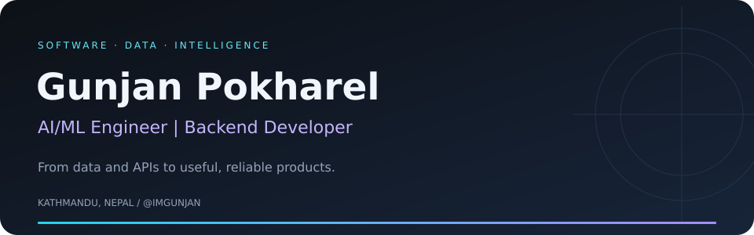
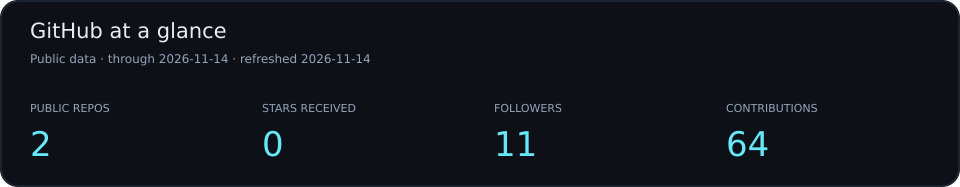
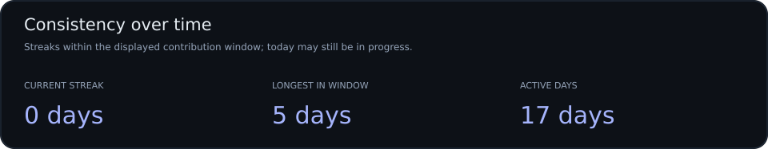
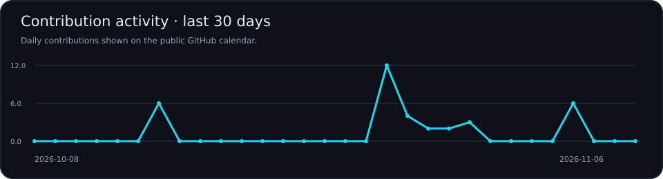
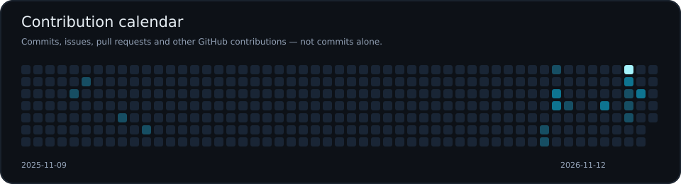
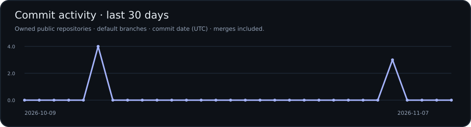

  

  <a href="https://github.com/imgunjan?tab=repositories">Explore my work</a> ·
  <a href="https://github.com/imgunjan/ak820-linux-studio">Featured project</a> ·
  <a href="https://github.com/imgunjan?tab=overview">GitHub activity</a>

## Hi, I'm Gunjan 👋

I build backend systems and AI/ML solutions that turn data into practical tools. My work brings together software engineering, machine learning pipelines, and deployment—with a focus on reliability, performance, and maintainability.

Based in **Kathmandu, Nepal**, I'm interested in the full journey from raw data to a useful product: designing APIs, building data pipelines, deploying models, and improving the systems around them.

### What I focus on

| Backend engineering | AI & machine learning | Reliable delivery |
| :--- | :--- | :--- |
| API design and scalable services | End-to-end ML pipelines | Cloud-native deployments |
| Data ingestion and processing | Model integration and deployment | MLOps and system optimization |
| Performance and maintainability | Practical, data-driven tools | Continuous learning and improvement |

## Featured projects

### ⌨️ [AK820 Linux Studio](https://github.com/imgunjan/ak820-linux-studio)

A native Linux utility for customizing the **AJAZZ AK820 Pro** keyboard's TFT display. Preview and prepare images, animated GIFs, and text cards, or sync the keyboard clock from Linux.

**Built with:** Python · Tkinter · Pillow · USB HID  
**Status:** Preview release; physical hardware validation is still pending.

[Explore the source →](https://github.com/imgunjan/ak820-linux-studio#readme)

[Browse all public repositories →](https://github.com/imgunjan?tab=repositories)

## GitHub analytics

  

## Contribution streak

  

## Contribution activity

  
  

## Commit graph

  

Cards refresh daily. Stars are received stars across owned public repositories. Contributions include more than commits; commit activity covers owned public repositories only. The longest streak is measured within the displayed calendar window. Last successful images remain visible if a refresh fails.

---

<b>Build useful things. Understand how they work. Keep improving.</b>

